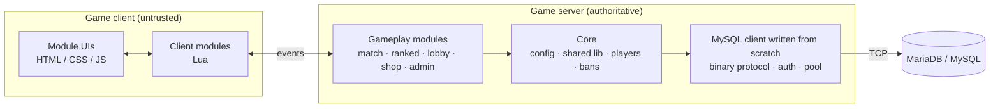

I like understanding what sits under the abstraction, then building it myself when that is the better call. My main playground is **multiplayer game servers on FiveM**: real players, real concurrency, and clients that cannot be trusted. At **Epitech**, I work on the theory side: computer vision, machine learning, probability and statistics.

  <a href="#-bpw-pvp--a-competitive-game-server-built-from-scratch">Game server</a> ·
  <a href="#-14k-pvp--a-virtual-economy-that-has-to-stay-correct">Transactions</a> ·
  <a href="#-sudoku-vision--from-a-phone-photo-to-a-solved-grid">Computer vision</a> ·
  <a href="#-action_logger--an-audit-pipeline-that-survives-outages">Observability</a> ·
  <a href="#-theory-i-actually-use">Theory</a>

---

## ⚔️ BPW PvP — a competitive game server built from scratch

Most FiveM servers assemble an existing framework (ESX, QBCore) with third-party scripts. I wrote my own instead, so that every layer is understood, and nothing runs that the game mode does not need.

**About 31,000 lines of Lua, JS, CSS and SQL · 29 gameplay modules · no game framework · no npm dependency in the database layer**

**What makes it interesting**

- **A MySQL client written by hand, on raw TCP (688 lines).** It implements the wire protocol directly from the specification using only Node's `net` and `crypto`: handshake v10, binary packet parsing, multiple result sets, connection pooling and client-side parameter escaping.
- **Real authentication, not just queries.** It supports `mysql_native_password` and `caching_sha2_password`, including the fast path and the full RSA exchange, so it works against both MySQL and MariaDB.
- **A dependency-ordered module system.** Each feature is a self-contained module that declares its dependencies and optional UI. The boot sequence starts modules in dependency order, so adding a feature does not mean touching the core.
- **Matchmaking as a state machine.** Lobbies move through `IDLE → QUEUE → FOUND → MATCH`, with a ready check and a return path if someone declines. Queued lobbies are assembled into complete teams for ELO-ranked 4v4, and players can also queue for 1v1 duels.
- **Don't trust the client.** Sensitive actions are checked on the server. For example, a client reporting a death it did not suffer during a ranked match gets logged as a cheating attempt.
- **Versioned schema.** Database changes go through numbered SQL migrations applied by the core.

The same architecture now also powers **Five Battle Royal**, a 5v5 battle royale on Cayo Perico, which shows the design holds up beyond a single game mode.

## 🎰 14K PVP — a virtual economy that has to stay correct

A case-opening website whose database is shared with a live game server. It handles virtual currency, so race conditions and double spending are the real problems to solve.

`Next.js 16` `React 19` `TypeScript` `Drizzle ORM` `MariaDB`

| Problem | Solution |
|---|---|
| Two simultaneous requests spend the same balance | Database transactions with row-level locking (`SELECT … FOR UPDATE`) on the wallet |
| A deposit from the game is delivered twice | Idempotent operations keyed on a unique `ref` |
| Balance history must be auditable | Append-only ledger of every currency movement |
| Draw results must not be predictable | Weighted draw on the server with a CSPRNG (`crypto.randomInt`) |
| Website and game must not corrupt each other | The site never writes to game tables; all exchanges go through a documented API |

## 🧩 Sudoku Vision — from a phone photo to a solved grid

Team project with three people at Epitech. **My role: models and data**, meaning the datasets, YOLO training and experiment tracking in MLflow.

`Python` `YOLO11` `OpenCV` `MLflow` `FastAPI` `Streamlit`

<table>
  <tr>
    <td align="center"><h3>97.6%</h3>of sudokus solved end to end (40 of 41 unseen photos)</td>
    <td align="center"><h3>99.51%</h3>accuracy on 405 real, hand-labelled cells</td>
    <td align="center"><h3>0%</h3>wrong solutions returned on the test set</td>
    <td align="center"><h3>0.16 s</h3>average processing time per photo</td>
  </tr>
</table>

**The method matters more than the score:**

- **Data leakage prevented.** The photos include many shots of the same grid, so a naive split would inflate the results. Splits are made per grid, with an automatic check that no grid appears in two sets.
- **Models trained on the real failure modes.** Synthetic cells simulate imperfect warps, leftover grid lines and show-through from the back of the page. Augmentations that would change a digit's meaning are turned off.
- **99.5% per cell isn't enough.** Over 81 cells, small errors add up to a wrong grid. The sudoku rules therefore act as a quality check: when a grid is invalid, the least confident cells get repaired instead of a wrong answer being returned.
- **Every pipeline stage measured.** An ablation study quantifies what each stage adds, taking the solve rate from 85.4% with OpenCV alone to 97.6% with the full pipeline.

## 📜 action_logger — an audit pipeline that survives outages

A full logging platform for game servers, from the Lua resource to the web dashboard. Node / Express · SQLite · React · Discord OAuth2.

- **Built for failure:** bounded queue, batching and retries with exponential backoff when the API is unavailable.
- **Secure by design:** the API key exists only on the server, and everything sent from a client is validated again and rate limited.
- **Framework-agnostic:** works with ESX, QBCore, Qbox or standalone servers.
- **Usable:** role-based access, filters, per-player timeline, statistics and a live feed.

## 🎮 Also on FiveM

- **[bd_uno](https://github.com/badidu09/bd_uno)** — a multiplayer UNO table in the game world, with a full ruleset and several concurrent tables. *(open source)*
- **Large-scale map streaming** — a sky arena of 2.2 M triangles split into 92 tiles, with simplified collision meshes and chained texture dictionaries.
- **Skydrop** — a floating battle-royale lobby with a scripted drop sequence, 1,000 m above Cayo Perico.
- **nomercy_climb** — ledge detection using raycasts: checks surface angle, flatness and clearance before climbing.
- **Release tooling** — a Python build script for Cfx Asset Escrow that strips secrets and sources from the shipped package.

---

## 🧠 Theory I actually use

| Field | Concepts | Where |
|---|---|---|
| **Networking & protocols** | TCP, binary framing, handshakes, client-server authority | MySQL client, game server |
| **Cryptography** | Hash-based challenge-response, RSA, CSPRNG | MySQL auth, draw system |
| **Databases** | ACID transactions, row locking, idempotency, migrations | 14K PVP, BPW core |
| **Distributed reliability** | Retries, exponential backoff, batching, back-pressure | action_logger |
| **Algorithms** | Backtracking, constraint propagation with MRV, state machines, dependency ordering | Sudoku solver, matchmaking, module boot |
| **Machine learning** | Object detection, classification, data leakage, augmentation, mAP, ablation studies | Sudoku Vision |
| **Computer vision** | Homography, perspective transforms, contour analysis, interpolation | Sudoku Vision |
| **Probability & statistics** | Probability laws, regression, hypothesis testing, confidence intervals | [Epitech math projects](https://github.com/badidu09/MATH_PROJECT) |

## 💻 Tools

   
   
  

  

  Most of my game server code lives in private repositories. Happy to walk through it in an interview.  
  

